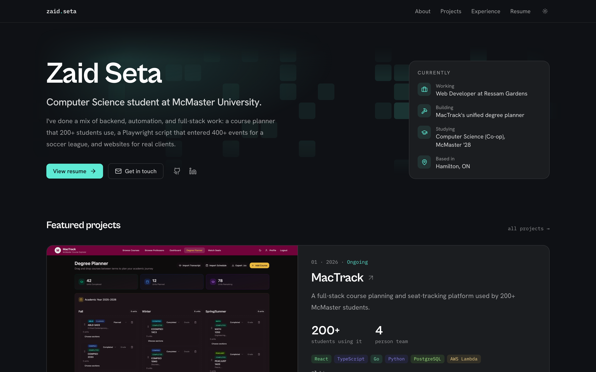
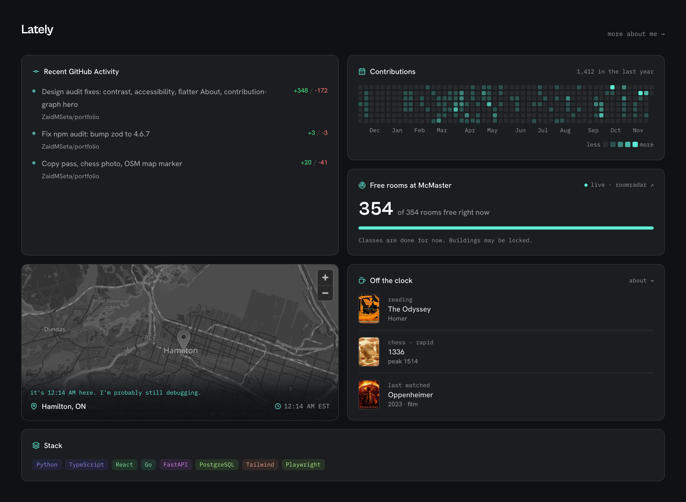
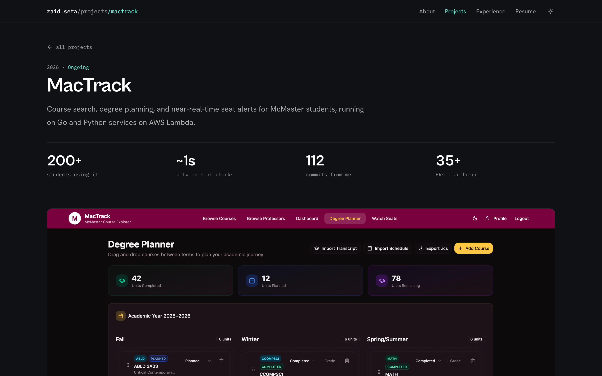
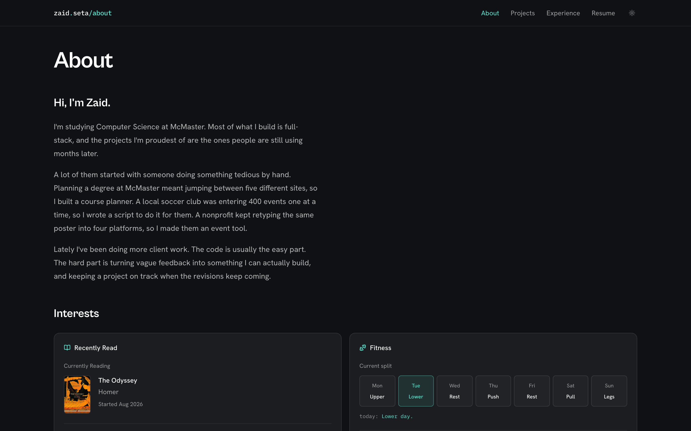
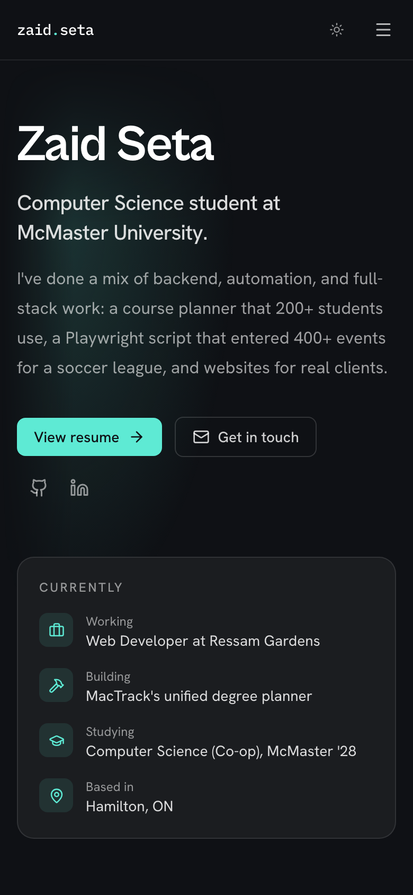
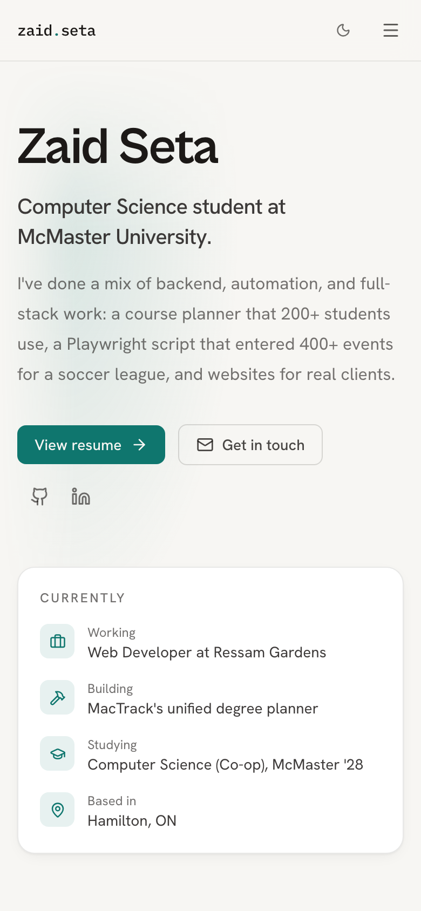

<h1 align="center">zaid.seta</h1>

<p align="center">
  My personal site: projects, work, and a few live tiles about what I've been up to.<br>
  <a href="https://zaid-seta-portfolio.vercel.app"><strong>zaid-seta-portfolio.vercel.app</strong></a>
</p>

<p align="center">
  
  
  
  
  
</p>

<picture>
  <source media="(prefers-color-scheme: dark)" srcset="docs/screenshots/home-dark.png">
  <source media="(prefers-color-scheme: light)" srcset="docs/screenshots/home-light.png">
  
</picture>

## What's on it

- **Home**: intro over a backdrop drawn from my real GitHub contribution graph, featured projects, an experience snapshot, and a grid of live tiles
- **Projects**: every project, each with a case study (problem, approach, numbers, stack)
- **Experience**: work history
- **About**: a short bio plus what I'm reading, watching, lifting, and my chess rating
- **Resume**: open or download the PDF

### Live tiles



| Tile | Source |
|---|---|
| Recent GitHub activity | GitHub API, fetched in the browser with diff stats |
| Contribution calendar | GitHub, committed JSON refreshed daily |
| Free rooms at McMaster | [RoomRadar](https://macroomradar.vercel.app) schedule, computed in the browser from `public/roomradar.json` |
| Hamilton map + local time | OpenStreetMap embed and my local time |
| Reading | Hardcover, committed JSON |
| Chess | Chess.com API live, plus a committed rating history |
| Last watched | Trakt + TMDB, committed JSON |

### Case studies and About

<table>
  <tr>
    <td width="50%"></td>
    <td width="50%"></td>
  </tr>
</table>

### Mobile, both themes

<p align="center">
  
  &nbsp;&nbsp;
  
</p>

Light and dark themes follow the system setting by default, and the toggle in the header overrides it. The site aims for WCAG 2.2 AA: keyboard navigation with a skip link, visible focus rings, and reduced motion when `prefers-reduced-motion` is set.

## Stack

- **React 19** + **TypeScript**, **React Router 7**
- **Tailwind CSS 4** with theme tokens in `src/styles/globals.css`
- **Recharts** for the chess rating chart
- **Vite** for builds, **Vercel** for hosting and analytics

## Getting started

```bash
npm install
cp .env.example .env   # only needed for the fetch scripts
npm run dev
```

The data files in `src/data/` are committed, so the site builds and runs without any secrets. To refresh them yourself, fill in `.env` and run the fetch scripts below.

## Scripts

| Command | What it does |
|---|---|
| `npm run dev` | Start the dev server |
| `npm run build` | Production build |
| `npm run preview` | Serve the production build locally |
| `npm run lint` | Run ESLint |
| `npm run fetch:hardcover` | Reading data from Hardcover |
| `npm run fetch:trakt` | Watch history from Trakt + TMDB |
| `npm run fetch:chess` | Regenerate the Chess.com rating history |
| `npm run fetch:github` | GitHub contribution calendar (no token needed) |
| `npm run fetch:rooms` | RoomRadar's term schedule (no token needed) |

## How the data stays fresh

The **Refresh data** GitHub Action runs the fetch scripts every morning and commits anything new, which triggers a redeploy. It needs `HARDCOVER_API_TOKEN`, `TRAKT_CLIENT_ID`, `TRAKT_USERNAME` and `TMDB_API_KEY` as repository secrets. You can also run it by hand from the Actions tab.

## Link previews and SEO

At build time `scripts/seoPages.mjs` writes a copy of `index.html` for every route (`about.html`, `projects/mactrack.html`, ...) with its own title, description, and preview image, plus `sitemap.xml` and `robots.txt`. That way crawlers that don't run JavaScript (LinkedIn, iMessage, Slack) still get the right tags. The site origin lives in `site.url`. Preview cards are in `public/og/`, and `scripts/ogCards.mjs` regenerates their HTML templates for screenshotting.

## Deployment

Deployed on Vercel. Every route has its own prerendered HTML file, and `vercel.json` turns on `cleanUrls`, so `/projects/mactrack` serves `projects/mactrack.html`. There's no catch-all rewrite: unknown paths fall through to `404.html`, which boots the app and shows the not-found page with a real 404 status. New routes need an entry in `scripts/seoPages.mjs`.

`vite.config.js` injects `__COMMIT_SHA__` and `__BUILD_DATE__` at build time (from `VERCEL_GIT_COMMIT_SHA` on Vercel, `git rev-parse` locally), and `__PROJECT_SHOTS__`, the list of project screenshots in `public/projects/`.

## License

[MIT](LICENSE)
